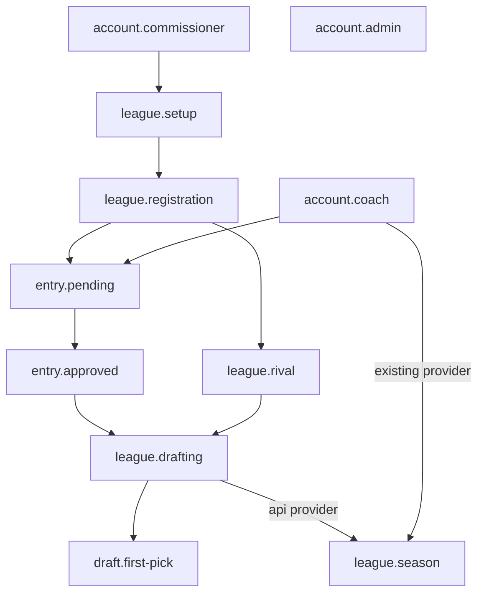

# The prerequisite engine

Most flows need the app in some state first: a league open for registration, a coach approved, a draft under way. The engine builds that state for each flow, the fastest way that's allowed, and tells you how and why.

## States and providers

A **state** is something a flow can `require`. It names the states it needs, and one or more **providers** that can build it:

- `api`: through the API (fast; the default)
- `ui`: through the screens (when the flow is about those screens)
- `existing`: by finding data that's already there (the configured admin, the demo league)

```ts
export const registration = defineState({
    id: "league.registration",
    title: "The league, open for registration",
    requires: ["league.setup"],
    providers: {
        api: { build: async (ctx) => { /* POST /open-registration */ } },
        ui:  { build: async (ctx) => { /* click "Open registration" */ } },
    },
});
```

A provider can need more than its state does (`requires` on the provider), and can say it isn't usable in this run (`available(run)` returns a reason).



## The planner's rules

`plan()` is a pure function: no I/O, so `npm run plan` shows exactly what a run will do, and the self-tests check every flow's plan without the app.

For each state, depth first, the provider is chosen **before** visiting its needs, so an API path never plans a UI sign-in:

1. **The flow's pin** (`pins: { "league.drafting": "ui" }`). Always wins; a pin that can't work is a mistake in the flow (`PlanError`).
2. **The run's request** (`DRAFTDEX_RUN_REQUEST='{"providers":{"league.setup":"ui"}}'`). Used when possible; otherwise the default, with the reason recorded.
3. **The default order**: api, ui, existing. The first that exists, is allowed and is available.

API flows allow only `api` and `existing`, so they never open a browser. Every step records its reason:

```text
$ DRAFTDEX_RUN_REQUEST='{"providers":{"league.setup":"ui"}}' npm run plan -- draft.pick league.ui-my-leagues

draft.pick  (api)
 1. account.commissioner  api       default
 2. league.setup          api       fallback: requested ui, but ui isn't allowed in this flow
 ...
league.ui-my-leagues  (ui)
 1. account.commissioner  api       default
 2. league.setup          ui        requested for this run
 ...
```

The planner refuses unknown states and cycles, naming the path (`Cycle in prerequisites: a → b → a`).

## Running a plan

`resolvePlan()` runs each step as its own boxed test step, `PREREQ › The league, open for registration (api)`, and adds annotations to the report:

- `plan`: the whole plan with reasons
- `created`: everything the providers made (accounts, leagues, entries), with ids
- `blocked`: why a prerequisite failed

## BLOCKED vs FAILED vs skipped

| What happened | Result |
| --- | --- |
| The flow's own steps failed | **Failed**: the feature is broken |
| A prerequisite couldn't be built | Failed with `BLOCKED by prerequisite "…" (api): …` and a `blocked` annotation: the setup broke, not (necessarily) this feature |
| This environment can't run the flow (e.g. no admin account in `.env`) | **Skipped**, with the reason: `Can't run in "local": No provider can build "account.admin" (existing: set DRAFTDEX_ADMIN_EMAIL and DRAFTDEX_ADMIN_PASSWORD in .env)` |
| The flow itself is wrong (unknown state, impossible pin) | Fails `--list` at load time, before any run |

## Adding a state

1. Add its id and value type to `src/states/values.ts`.
2. `defineState({...})` in `src/states/`.
3. List it in `src/states/registry.ts`.

`npm run test:internal` then checks its requirements exist, it can be planned, and every flow still plans.
